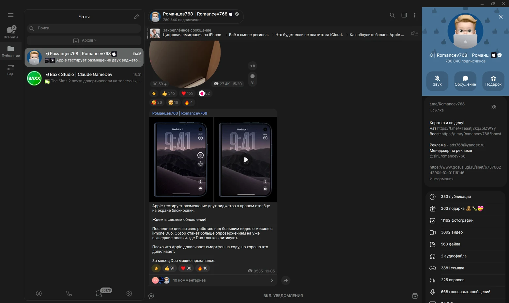
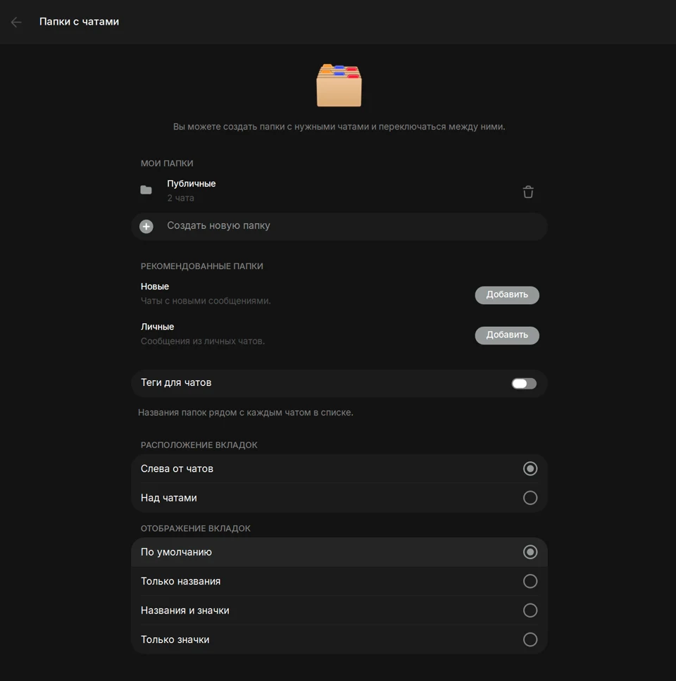
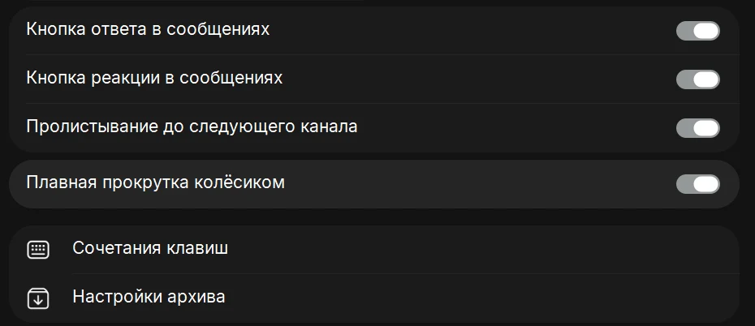

# MTW-Gram

MTW-Gram is an unofficial Telegram client for Windows. It builds on Telegram Desktop and brings a macOS-inspired interface to chats, folders, and settings.

**[Download the Windows x64 beta](https://github.com/Doffi4/MTW-Gram/releases/tag/v0.2.4-beta)** · [All releases](https://github.com/Doffi4/MTW-Gram/releases) · [Русский](README.ru.md) · [Changelog](CHANGELOG.md)

## Demo

[](https://github.com/Doffi4/MTW-Gram/releases/download/v0.2.4-beta/MTW-Gram-0.2.4-beta-demo.mp4)

**[Watch the 29-second demo (MP4)](https://github.com/Doffi4/MTW-Gram/releases/download/v0.2.4-beta/MTW-Gram-0.2.4-beta-demo.mp4)** · Switch between public channels, scroll a feed, and return to chats from folder settings.

| Folder settings | Optional smooth wheel scrolling |
| :---: | :---: |
|  |  |

## What's different

- **Chats and folders** have a floating sidebar, configurable folder tabs, and a capsule composer that keeps replies and edits next to the text field.
- **Navigation** animates when switching chats, returning from settings, and opening or closing a forum's topic list.
- **Chat Settings** includes optional smooth scrolling for a mouse wheel. Settings open inside the main window and group related controls into cards.

## Install

1. [Download the Windows x64 ZIP](https://github.com/Doffi4/MTW-Gram/releases/download/v0.2.4-beta/MTW-Gram-0.2.4-beta-win64.zip).
2. Extract it to its own writable folder and run `Telegram.exe`. This beta is unsigned.
3. To update, use **Settings → General → Check for updates**. If you update manually, keep the `tdata` folder next to `Telegram.exe`.

## Build from source

MTW-Gram uses C++ and Qt. Its changes live in two Git patches over Telegram Desktop 7.4.4. Run these commands from the repository root in a Windows x64 Visual Studio Developer Command Prompt with MSVC 14.44, ATL, a Windows SDK, Git, and Python. Prepare the dependencies using the [upstream Windows build guide](https://github.com/telegramdesktop/tdesktop/blob/bf4f714036f21c750d535dab199c811b3f9bfdd4/docs/building-win.md).

```bat
git clone https://github.com/telegramdesktop/tdesktop.git refs/tdesktop
git -C refs/tdesktop checkout --detach bf4f714036f21c750d535dab199c811b3f9bfdd4
git -C refs/tdesktop submodule update --init --recursive
git -C refs/tdesktop apply --binary ../../patches/tdesktop.patch
git -C refs/tdesktop/Telegram/lib_ui apply --binary ../../../../patches/lib_ui.patch
call refs\tdesktop\Telegram\build\prepare\win.bat
```

For a local Debug build, run `tools\build-win.bat Debug`. For Release, configure with your own [Telegram API credentials](https://core.telegram.org/api/obtaining_api_id/). Keep the credentials and CMake cache local.

```bat
pushd refs\tdesktop\Telegram
call configure.bat x64 -D TDESKTOP_API_ID=YOUR_API_ID -D TDESKTOP_API_HASH=YOUR_API_HASH -D TDESKTOP_API_TEST=OFF -D DESKTOP_APP_DISABLE_AUTOUPDATE=ON -D DESKTOP_APP_DISABLE_CRASH_REPORTS=ON
popd
call tools\build-win.bat Release
python -m unittest discover -s tools -p "test_*.py"
```

The executable is under `refs\tdesktop\out\Release`. Both upstream revisions are recorded in [patches/BASE](patches/BASE). The build documentation and patches in this repository are covered by [GPL-3.0-or-later](LICENSE). See the [upstream notice](LEGAL.upstream) for the OpenSSL exception and upstream copyright.
