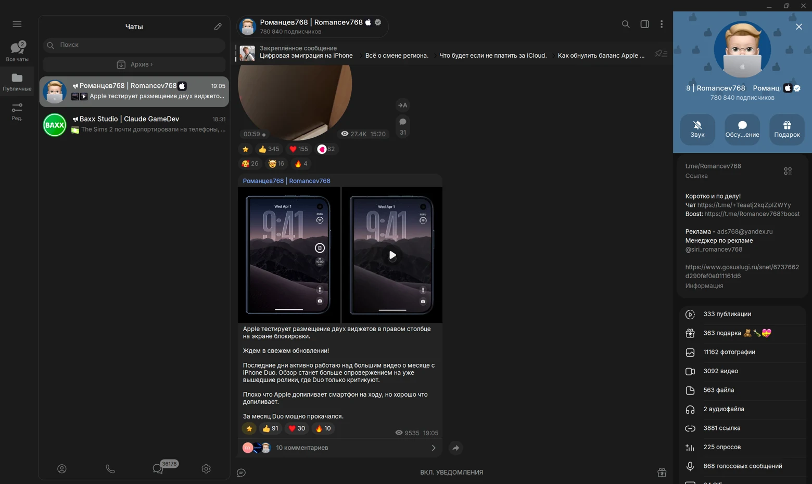
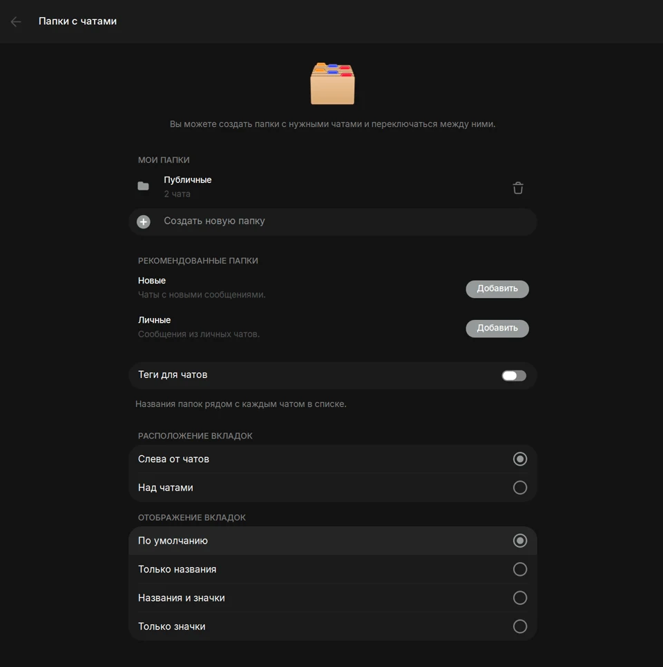
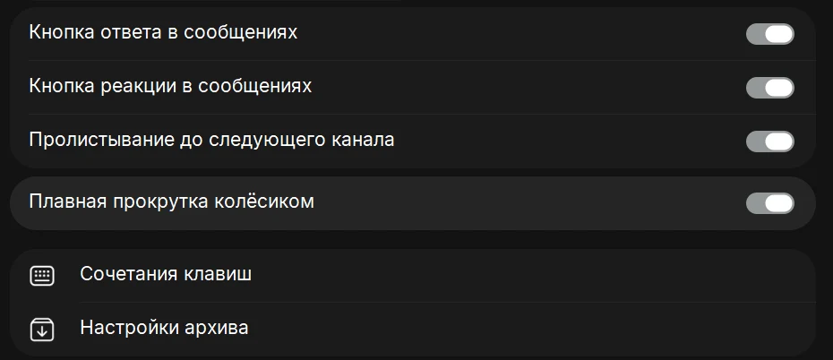

# MTW-Gram

MTW-Gram — неофициальный клиент Telegram для Windows на базе Telegram Desktop. Чаты, папки и настройки оформлены в стиле Telegram для macOS.

**[Скачать бета-версию для Windows x64](https://github.com/Doffi4/MTW-Gram/releases/tag/v0.2.4-beta)** · [Все релизы](https://github.com/Doffi4/MTW-Gram/releases) · [English](README.md) · [История изменений](CHANGELOG.md)

## Демо

**[Посмотреть демо за 29 секунд (MP4)](https://github.com/Doffi4/MTW-Gram/releases/download/v0.2.4-beta/MTW-Gram-0.2.4-beta-demo.mp4)** · Переключение между публичными каналами, прокрутка ленты и возврат к чатам из настроек папок.

| Настройки папок | Плавная прокрутка колёсиком |
| :---: | :---: |
|  |  |

## Что изменилось

- **Чаты и папки.** Плавающая боковая панель, настраиваемые вкладки папок и поле ввода, в котором ответ и редактирование остаются рядом с текстом.
- **Переходы.** Клиент анимирует смену чатов, возврат из настроек и открытие или закрытие списка тем форума.
- **Настройки чатов.** Можно включить плавную прокрутку колёсиком мыши. Настройки открываются в главном окне, связанные параметры собраны в карточки.

## Установка

1. [Скачайте ZIP для Windows x64](https://github.com/Doffi4/MTW-Gram/releases/download/v0.2.4-beta/MTW-Gram-0.2.4-beta-win64.zip).
2. Распакуйте архив в отдельную папку с правом записи и запустите `Telegram.exe`. Бета-сборка без цифровой подписи.
3. Для обновления откройте **Настройки → Общие → Проверить обновления**. При ручном обновлении сохраните папку `tdata` рядом с `Telegram.exe`.

## Исходники

Клиент написан на C++ и Qt. Изменения лежат в двух Git-патчах поверх Telegram Desktop 7.4.4 и его версии `lib_ui`. Порядок сборки есть в [английском README](README.md#build-from-source), базовые коммиты указаны в [patches/BASE](patches/BASE). Лицензия — [GPL-3.0-or-later](LICENSE). Исключение для OpenSSL и копирайт апстрима описаны в [LEGAL.upstream](LEGAL.upstream).
